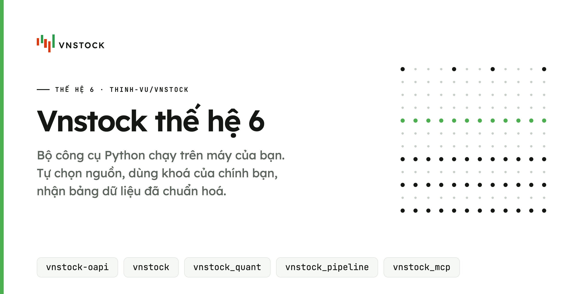
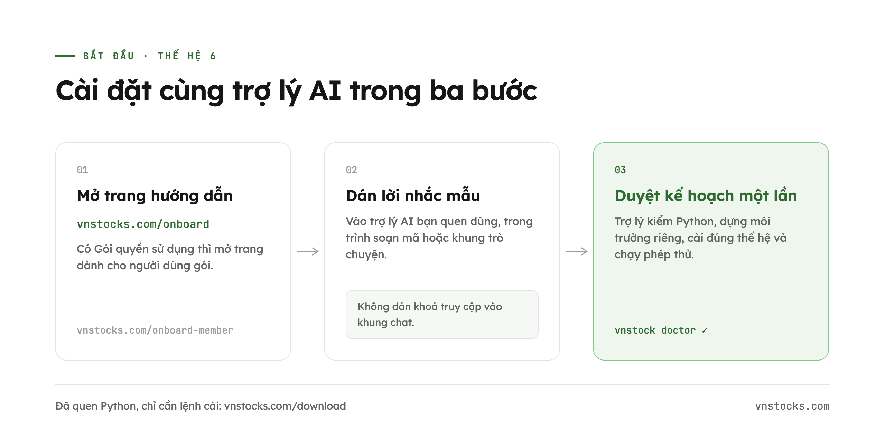
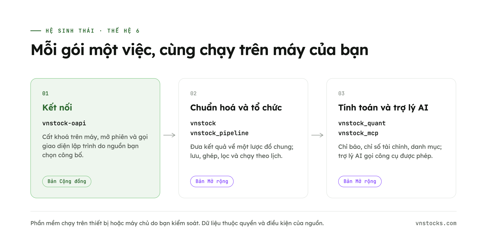

# Vnstock

**Vnstock là hệ sinh thái tự động hoá cá nhân trong nghiên cứu đầu tư: bộ công cụ Python chạy trên máy của bạn để kết nối dữ liệu, tính toán định lượng có công thức minh bạch và tự động hoá quy trình phân tích, cùng trợ lý AI viết code đúng ngay lần đầu.**

> [!IMPORTANT]
> Kho này ghi lại một giai đoạn phát triển trước đây của thư viện `vnstock` và không còn là nơi phát triển mã nguồn của sản phẩm hiện hành.
>
> Từ thế hệ 5, `vnstock` dùng nhân xử lý Rust với lớp giao diện Python và được phát hành dạng gói dựng sẵn qua kho phân phối chính thức của Vnstock. Phiên bản mới nhất thuộc **thế hệ 6**. Mã của các phiên bản cũ không còn được duy trì hoặc công bố trên nhánh chính của kho này.
>
> Các phiên bản trước thế hệ 6 ngừng hoạt động từ ngày **10/11/2026**. Nếu đang dùng thế hệ 5 hoặc cũ hơn, hãy cài thế hệ 6 trong một môi trường riêng và chuyển các phần quan trọng theo hướng dẫn bên dưới.

[English below](#english)

## Trạng thái của kho này

- Nội dung còn lại chỉ phục vụ việc nhận diện dự án và ghi nhận lịch sử phát triển.
- Không cài đặt `vnstock` từ kho này và không gửi pull request để tiếp tục phát triển mã của các phiên bản cũ.
- Tài liệu, hướng dẫn cài đặt và thông tin phiên bản hiện hành được cập nhật tại [vnstocks.com](https://vnstocks.com).
- Các dự án có mã được Vnstock công bố từ nay được đặt tại tổ chức [github.com/vnstock-hq](https://github.com/vnstock-hq), thay cho tài khoản GitHub cá nhân của tác giả.

*Đối chiếu lịch sử: [bản mã cuối cùng từng phát hành tại kho này](https://github.com/thinh-vu/vnstock/tree/71b853f0db18c0d783c2b9eeafaedbcbf4d05fba) chỉ còn giá trị tham khảo, không còn được duy trì và không đại diện cho Vnstock hiện hành.*

## Vnstock thế hệ 6

Thế hệ 6 giữ kiến trúc Rust core + Python wrapper đã được đưa vào từ thế hệ 5, đồng thời thay đổi cách phần mềm kết nối với nguồn. Bạn chủ động chọn nguồn, dùng tài khoản và mã khoá do nguồn đó cấp; Vnstock đảm nhiệm lớp kết nối, chuẩn hoá khác biệt và đưa kết quả về một giao diện Python thống nhất.

- **Bạn chọn nguồn.** Nguồn được chỉ định trong lời gọi hàm hoặc cấu hình của bạn; Vnstock không âm thầm đổi nguồn.
- **Bạn giữ khoá.** Mã khoá của nguồn được cất trên máy và chỉ dùng cho kết nối tới nguồn đó. Đây là quyền riêng, tách biệt với quyền sử dụng phần mềm Vnstock.
- **Một lược đồ chung.** Tên cột, kiểu dữ liệu, đơn vị và mốc giờ được chuẩn hoá trên máy để phần phân tích phía sau ít phải đổi khi thay nguồn.
- **Lỗi được nói rõ.** Thư viện trả mã lỗi và hướng xử lý thay vì để quy trình tiếp tục với một bảng rỗng không rõ nguyên nhân.
- **Nguồn gốc đi cùng kết quả.** Kết quả có thể mang theo tên nguồn, thời điểm lấy và ngữ cảnh lời gọi để tiện đối chiếu, tái lập và làm việc cùng trợ lý AI.
- **Có đường chuyển tiếp.** Hồ sơ tương thích `v5` giữ nhiều tên cột và lời gọi quen thuộc; phạm vi dữ liệu vẫn phụ thuộc vào API và quyền mà từng nguồn cấp.

Đọc thêm: [Vnstock thế hệ 6 hoạt động thế nào](https://vnstocks.com/the-he-6) · [Khác biệt với thế hệ 5 và hướng dẫn chuyển đổi](https://vnstocks.com/blog/vnstock-the-he-6-cach-hoat-dong-va-khac-biet-voi-the-he-5)

## Bắt đầu: ưu tiên cài cùng trợ lý AI

Cách khuyên dùng là mở đúng trang hướng dẫn, sao chép lời nhắc mẫu vào trợ lý AI bạn đang dùng, đọc kế hoạch rồi duyệt một lần. Trợ lý sẽ kiểm tra Python, chuẩn bị môi trường riêng, cài đúng thế hệ, nạp chỉ dẫn cần thiết và chạy phép thử. Không gửi khoá truy cập vào khung chat của trợ lý AI.

| Bạn là ai | Bắt đầu tại | Luồng hướng dẫn |
| :-- | :-- | :-- |
| Người mới hoặc người dùng Bản Cộng đồng | [vnstocks.com/onboard](https://vnstocks.com/onboard) | Luồng chung cho mọi người dùng; ưu tiên cài bằng AI, có lựa chọn cài thủ công. |
| Người có Gói quyền sử dụng | [vnstocks.com/onboard-member](https://vnstocks.com/onboard-member) | Nhận diện cấp quyền, cài các thư viện tương ứng, quản lý thiết bị và xử lý lỗi. |
| Người đã quen Python và chỉ cần lệnh cài | [vnstocks.com/download](https://vnstocks.com/download) | Sao chép lệnh để tự chạy, không đi qua luồng trợ lý AI. |

Sau khi cài, tra cứu cú pháp và phạm vi hỗ trợ tại [tài liệu Vnstock thế hệ 6](https://vnstocks.com/docs/vnstock/v6).

> [!NOTE]
> Thế hệ 6 dùng cùng tên gói `vnstock` với thế hệ 5. Nếu đang có quy trình cũ, hãy cài thế hệ 6 trong một môi trường Python riêng để đối chiếu trước khi chuyển hoàn toàn.

## Vnstock hỗ trợ bạn như thế nào

- Kết nối tới nguồn bạn chọn và chuẩn hoá kết quả bằng bộ công cụ Python chạy trên thiết bị hoặc máy chủ của bạn.
- Tách việc kết nối, chuẩn hoá, lưu trữ và phân tích thành những phần có thể kiểm tra và thay thế độc lập.
- Hướng dẫn trợ lý AI dùng đúng hàm, tham số, cấu trúc đầu ra và quy ước của thư viện qua tài liệu và bộ kỹ năng chuyên biệt.

### Những giới hạn cần biết

- Vnstock không đóng vai trò nhà cung cấp dữ liệu. Vnstock không vận hành kho dữ liệu thị trường để bán lại.
- Vnstock không cấp tài khoản hoặc quyền truy cập của nguồn cho người dùng. Quyền sử dụng phần mềm không kèm quyền sử dụng dữ liệu của bên thứ ba.
- Vnstock không cổ vũ việc khai thác giao diện truy cập công khai của website. Người dùng cần có quyền phù hợp và tuân thủ điều kiện, giới hạn kỹ thuật của từng nguồn cùng pháp luật áp dụng.
- Vnstock không đưa khuyến nghị đầu tư.

## Giấy phép

Kho này không cấp quyền sử dụng mã nguồn của Vnstock thế hệ 5 hoặc thế hệ 6. Mỗi phiên bản hoặc tài liệu từng được phát hành chịu sự điều chỉnh của giấy phép đi kèm tại thời điểm phát hành. Giấy phép hiện hành của phần mềm Vnstock được công bố tại [vnstocks.com/onboard/giay-phep-su-dung](https://vnstocks.com/onboard/giay-phep-su-dung).

---

## English

**Vnstock is a personal-automation ecosystem for investment research: Python tools that run on your own machine to connect data, perform quantitative calculations with transparent formulas, and automate analysis workflows, with AI guidance for writing correct code.**

> [!IMPORTANT]
> This repository records an earlier stage of the `vnstock` library and is no longer the development home of the current product.
>
> Starting with generation 5, `vnstock` uses a Rust processing core with a Python interface and ships as prebuilt packages through Vnstock's official package index. The latest version belongs to **generation 6**. Earlier source is no longer maintained or published on this repository's main branch.
>
> Versions older than generation 6 stop working on **10 November 2026**. Install generation 6 in a separate environment and migrate important workflows using the guidance below.

*Historical reference: the [last code snapshot released in this repository](https://github.com/thinh-vu/vnstock/tree/71b853f0db18c0d783c2b9eeafaedbcbf4d05fba) is no longer maintained and does not represent the current Vnstock product.*

### What changes in generation 6

Generation 6 keeps the Rust-core and Python-interface architecture introduced in generation 5 while changing how the software connects to sources. You choose the source and use credentials issued by that source; Vnstock handles the connection, normalises differences, and presents a consistent Python interface.

- You explicitly choose the source; Vnstock does not silently switch it.
- Source credentials stay on your machine and are separate from your Vnstock software licence.
- Columns, types, units, and timestamps are normalised locally into a shared schema.
- Coded errors and suggested actions replace unexplained empty results.
- Source and retrieval context can travel with results for verification and reproducibility.
- A `v5` compatibility profile preserves many familiar calls and column names, while available data still depends on each source's interface and the access it grants.

Learn more: [How generation 6 works](https://vnstocks.com/the-he-6) · [Migration notes from generation 5](https://vnstocks.com/blog/vnstock-the-he-6-cach-hoat-dong-va-khac-biet-voi-the-he-5)

### Recommended setup: use an AI assistant

The recommended path is to copy the setup prompt from the appropriate onboarding page into your AI assistant, review its complete plan once, and then let it perform the approved steps. Never paste access keys into an AI chat.

- [General onboarding](https://vnstocks.com/onboard) — for new and Community users; AI-assisted setup is the default, with a manual option.
- [Member onboarding](https://vnstocks.com/onboard-member) — for users with a Vnstock software-access package; installs libraries available to their access tier and includes device and troubleshooting guidance.
- [Manual download](https://vnstocks.com/download) — for experienced Python users who only need the installation commands.

### Boundaries

Vnstock is client-side software, not a data provider. A software licence does not grant rights to third-party source data. Users must have appropriate access and comply with each source's terms, technical limits, and applicable law. Vnstock does not promote extracting data through publicly accessible website interfaces. The software and documentation are for study, research, and reference; they are not investment advice.

Current documentation: [vnstocks.com/docs/vnstock/v6](https://vnstocks.com/docs/vnstock/v6) · Published-code projects: [github.com/vnstock-hq](https://github.com/vnstock-hq)
